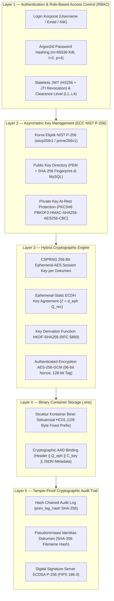
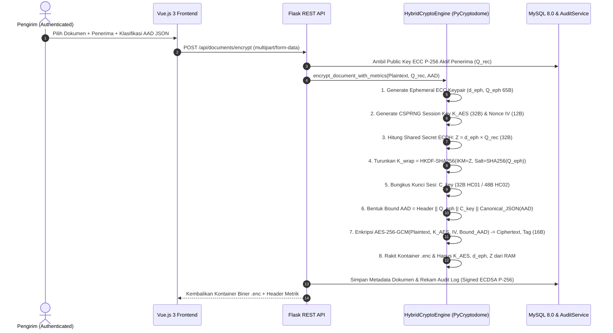
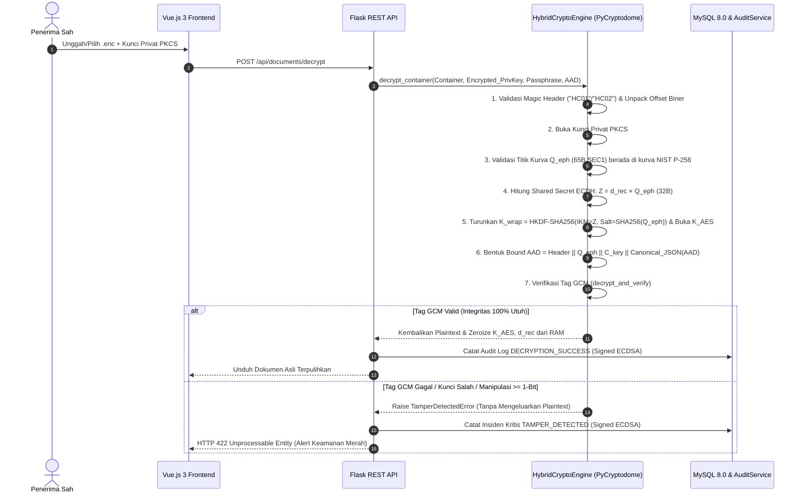

# Arsitektur Sistem & Pemodelan Ancaman Keamanan
## Pengembangan Framework Keamanan Informasi Internal Berbasis Kriptografi Hybrid AES-256 dan ECC untuk Perlindungan Dokumen Digital pada PT XYZ

---

## 1. Arsitektur 5 Lapisan Pertahanan (*5-Layer Defense-in-Depth*)

Framework ini mengimplementasikan arsitektur pertahanan berlapis (*Defense-in-Depth*) sesuai Bab III dan Bab IV Tesis serta standar **ISO/IEC 27001:2022 Klausul A.8.24 (Use of Cryptography)** dan **NIST SP 800-56A / SP 800-38D**:

---

## 2. Alur Proses Enkripsi Hybrid (AES-256-GCM + ECDH + HKDF-SHA256)

---

## 3. Alur Proses Dekripsi & Deteksi Manipulasi (*1-Bit Tamper Detection*)

---

## 4. Analisis Risiko Keamanan & Mitigasi Teknis

| ID | Ancaman / Risiko Keamanan | Dampak | Mitigasi Teknis yang Diimplementasikan |
| :--- | :--- | :--- | :--- |
| **R-01** | *Brute-Force* & *Credential Stuffing* pada Kredensial Login | Pengambilalihan akun pengguna | Hashing password menggunakan **Argon2id** (`m=65536 KiB, t=2, p=4`, salt acak 16-byte) disertai *sliding-window rate limiting* dan pencatatan di `authentication_logs`. |
| **R-02** | Kebocoran Kunci Privat ECC P-256 (*Private Key Compromise*) | Dekripsi tidak sah atas dokumen rahasia | Kunci privat tidak pernah disimpan dalam bentuk plaintext; wajib dienkripsi dengan standar **PKCS#8 (`PBKDF2WithHMAC-SHA256AndAES256-CBC`)** menggunakan passphrase pengguna. |
| **R-03** | Kompromi Kunci Sesi Masa Lalu (*Lack of Forward Secrecy*) | Seluruh dokumen ikut terbuka jika 1 kunci sesi bocor | Setiap enkripsi dokumen membangkitkan kunci sesi AES-256 baru (32-byte CSPRNG) dan pasangan kunci **Ephemeral ECC P-256 (`d_eph, Q_eph`)** sekali pakai. |
| **R-04** | *Nonce / IV Reuse* pada Mode AES-256-GCM | Kehancuran autentikasi GHASH dan kebocoran keystream | Setiap enkripsi menggunakan kombinasi kunci sesi sekali pakai dan fungsi `AESEngine.generate_unique_nonce(session_key)` berbasis CSPRNG 96-bit dengan deteksi kolisi per-kunci. |
| **R-05** | Manipulasi Ciphertext, Header `.enc`, atau Metadata Klasifikasi (*Bit-Flipping Attack*) | Pemalsuan isi dokumen atau penurunan level klasifikasi | Seluruh prefix biner (`Magic_Header || Q_eph || C_key`) serta JSON AAD kanonik diikat ke dalam **Additional Authenticated Data (AAD)** pada **AES-256-GCM**. Modifikasi 1-bit langsung menggagalkan `decrypt_and_verify` sebelum plaintext dikeluarkan. |
| **R-06** | *Broken Access Control* / *Insecure Direct Object Reference (IDOR)* | Staf mengakses dokumen milik pengguna lain | Pemeriksaan otorisasi berlapis di backend (`app/core/permissions.py` dan `app/api/documents.py`) yang memverifikasi pengirim, tabel `document_recipients`, serta kepemilikan kunci privat kriptografis. |
| **R-07** | Penghapusan atau Pemalsuan Jejak Audit (*Audit Log Tampering*) | Penyerang menghilangkan bukti insiden | Setiap baris `audit_logs` menyertakan rantai hash `prev_log_hash` (`SHA-256`) dan ditandatangani dengan **ECDSA NIST P-256 (FIPS 186-3)** menggunakan kunci privat server. |
