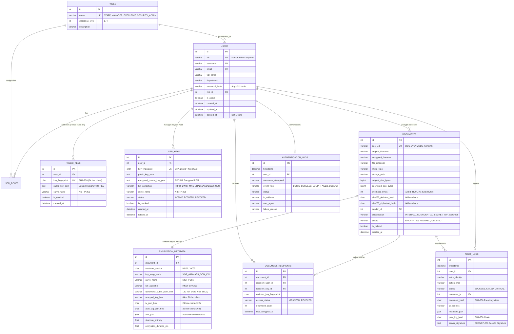

# Desain Database Relasional (MySQL 8.0) & Entity-Relationship Diagram (ERD)

---

## 1. Entity-Relationship Diagram (ERD)

Skema database mengintegrasikan struktur tabel utama pada Bab III Tesis (`roles`, `users`, `public_keys`, `audit_logs`) dengan tabel operasional manajemen dokumen dan siklus hidup kunci (`user_roles`, `user_keys`, `documents`, `document_recipients`, `encryption_metadata`, `authentication_logs`):

